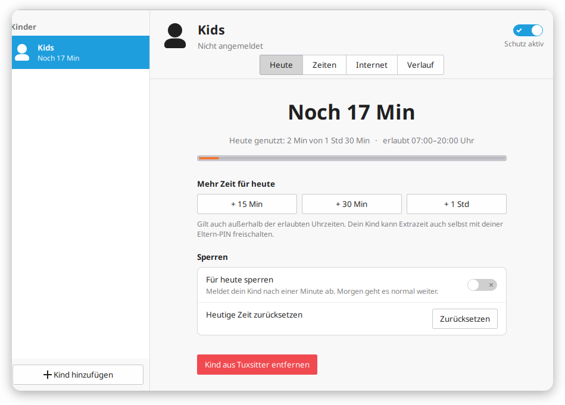
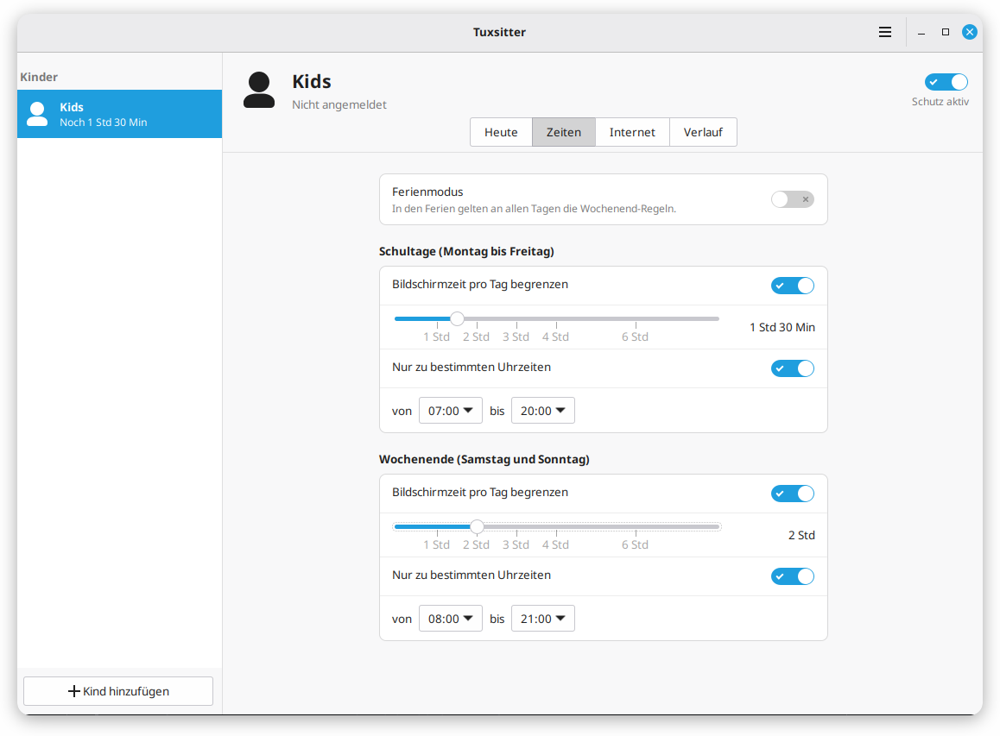
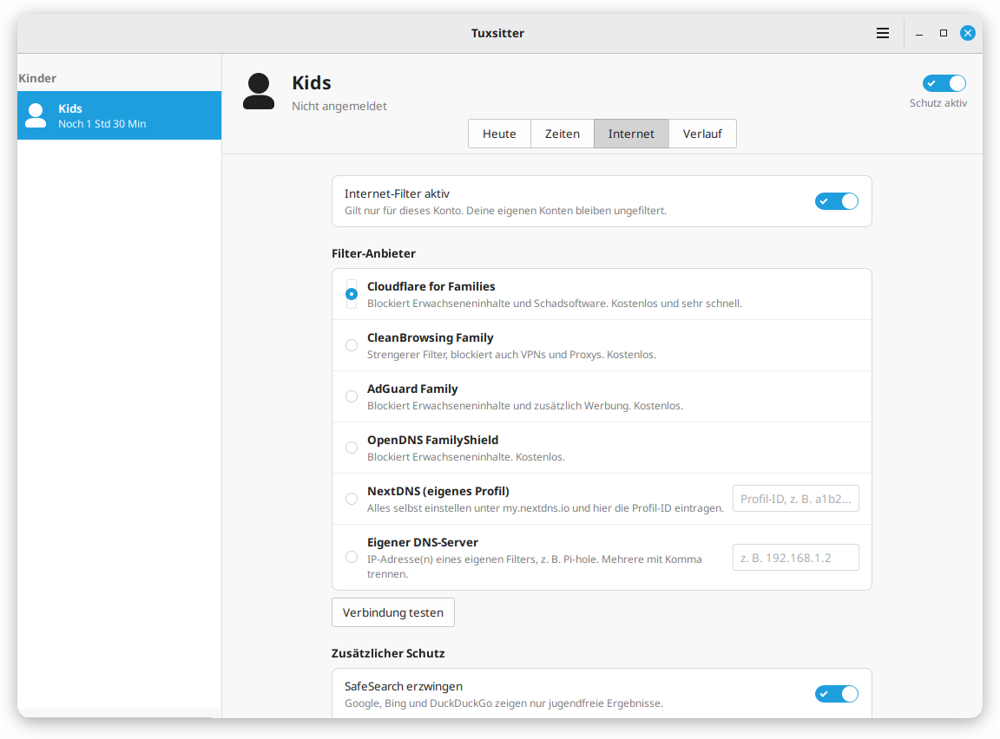
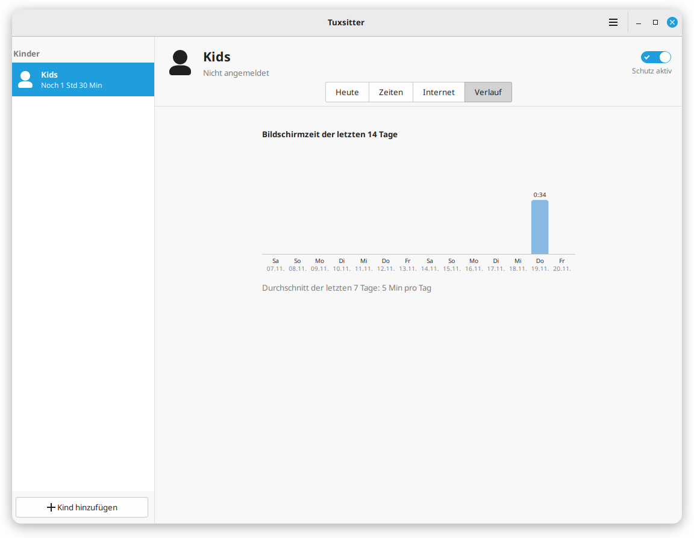

<p align="center">
  
</p>

<h1 align="center">Tuxsitter</h1>

<p align="center">
  <b>Einfache Kindersicherung für Linux</b><br>
  Bildschirmzeit · erlaubte Uhrzeiten · Internet-Filter nur für das Kinderkonto
</p>

<p align="center">
  <a href="README.md">English</a> · Deutsch
</p>

---

> [!IMPORTANT]
> **Frühe Version – Tester gesucht!**
> Tuxsitter wurde bisher nur grob auf dem Linux-Mint-Laptop des Autors getestet.
> Intensives Testen auf vielen verschiedenen Systemen kann eine einzelne Person nicht leisten –
> deshalb: **Probier es gern auf deinem System aus und [melde Fehler](https://github.com/chpusch/tuxsitter/issues)**.
> Auch eine kurze Rückmeldung, dass es auf deiner Distribution bzw. deinem Desktop *funktioniert*, hilft sehr. Danke!

Tuxsitter ist ein kleiner, freundlicher Babysitter für den Familien-PC. Gemacht für **Linux Mint**
(Cinnamon), läuft auch auf anderen Ubuntu-/Debian-basierten Desktops. Eltern bekommen ein
einfaches Fenster, das Kind sieht im Panel, wie viel Zeit noch übrig ist.

## Funktionen

- ⏱ **Bildschirmzeit pro Tag** – getrennt für Schultage und Wochenende, dazu ein Ferienmodus
- 🕖 **Erlaubte Uhrzeiten** – z. B. nur zwischen 07:00 und 20:00 Uhr
- ⚠️ **Faire Vorwarnung** – Hinweise bei 15, 5 und 1 Minute, dann 60 Sekunden Countdown bis zur Abmeldung
- 🔑 **Extrazeit per Eltern-PIN** – direkt am PC des Kindes, ohne Anmelden
- 🌐 **Internet-Filter nur für das Kinderkonto** – deine eigenen Konten bleiben unberührt
  - Familienfilter wählbar: Cloudflare for Families, CleanBrowsing, AdGuard Family,
    OpenDNS FamilyShield, **eigenes NextDNS-Profil** oder eigener Server (z. B. Pi-hole)
  - **SafeSearch** erzwungen für Google, Bing und DuckDuckGo
  - **YouTube eingeschränkter Modus** (moderat oder streng)
  - **Typische Tricks gesperrt**: verschlüsseltes DNS (DoH/DoT) fremder Anbieter, fest eingetragene
    öffentliche DNS-Server, der Tor-Download
- 📊 **Verlauf** der letzten 14 Tage
- 🛡 **Schwer auszutricksen** – läuft als Systemdienst; ein Kind ohne Admin-Rechte kann ihn nicht beenden.
  Tuxsitter warnt, wenn das Kinderkonto Admin-Rechte hat, und kann sie entfernen.
- 🌍 **Sprachen**: Deutsch, English, Français, Español

## Screenshots

<table>
  <tr>
    <td align="center"><br><sub>Heute: Restzeit, Extrazeit, Sperre</sub></td>
    <td align="center"><br><sub>Zeiten: Schultage, Wochenende, Ferien</sub></td>
  </tr>
  <tr>
    <td align="center"><br><sub>Internet: Familienfilter wählen</sub></td>
    <td align="center"><br><sub>Verlauf der letzten 14 Tage</sub></td>
  </tr>
</table>

## Installation

1. `tuxsitter_<version>_all.deb` unter [Releases](https://github.com/chpusch/tuxsitter/releases) herunterladen.
2. Doppelklick → **Paket installieren**, oder im Terminal:
   ```sh
   sudo apt install ./tuxsitter_*_all.deb
   ```
3. **Tuxsitter** im Startmenü öffnen (fragt nach deinem Passwort).

Selbst bauen: `./tools/build-deb.sh` erzeugt `build/tuxsitter_<version>_all.deb`.

## Einrichtung

1. **Eltern-PIN festlegen** (beim ersten Start) – damit gibst du am Kinder-PC Extrazeit frei.
2. **Kind hinzufügen** – vorhandenes Konto wählen oder neues anlegen.
3. **Zeiten** – Tageslimits und erlaubte Uhrzeiten für Schultage und Wochenende.
4. **Internet** – Filter-Anbieter wählen und **Verbindung testen**.
   Für NextDNS die Profil-ID von [my.nextdns.io](https://my.nextdns.io) → *Einrichtung* eintragen.
5. Kind einmal ab- und wieder anmelden – die Restzeit erscheint oben im Panel.

> 💡 Das Kinderkonto darf **kein Administrator** sein, sonst könnte es Tuxsitter einfach abschalten.
> Für mehr Sicherheit ein BIOS-/UEFI-Passwort setzen und Booten von USB sperren.

## So funktioniert es

| Teil | läuft als | Aufgabe |
|---|---|---|
| `tuxsitter.service` | root (systemd) | zählt Zeit, meldet ab, betreibt den DNS-Filter |
| Eltern-App (`tuxsitter`) | root über pkexec | Einstellungen, Extrazeit, Verlauf |
| Zeitanzeige im Panel | das Kind | Restzeit, Warnungen, PIN-Dialog |

**Bildschirmzeit:** Alle 10 Sekunden fragt der Dienst `systemd-logind`, ob das Kind angemeldet und der
Bildschirm entsperrt ist, und zählt diese Zeit. Ist das Limit oder die Uhrzeit erreicht, läuft eine
Minute Countdown, dann wird das Kind abgemeldet.

**Internet-Filter:** Linux weiß bei jedem Netzwerkpaket, welches Konto es geschickt hat. Eine
`nftables`-Regel leitet *alle DNS-Anfragen des Kinderkontos* (Port 53, egal an welchen Server) auf einen
kleinen DNS-Weiterleiter im Dienst um, der nur lokal lauscht. Er sperrt Umgehungs-Adressen, biegt
Suchmaschinen auf SafeSearch und YouTube auf den eingeschränkten Modus um und reicht alles andere an den
gewählten Filter weiter – bei NextDNS verschlüsselt über HTTPS. Öffentliche DNS-Server (1.1.1.1, 8.8.8.8 …)
und DNS-over-TLS sind für das Kinderkonto gesperrt. Fällt der Filter aus, gibt es **kein** Internet statt
ungefiltertem Internet. Deine eigenen Konten fragen weiter ganz normal deinen Router.

## Datenschutz

- Keine Konten, keine Cloud, keine Telemetrie. Alles bleibt in `/etc/tuxsitter` und `/var/lib/tuxsitter`.
- Tuxsitter speichert **nicht**, welche Seiten dein Kind besucht – nur die Bildschirmzeit.
- Die DNS-Anfragen des Kinderkontos gehen an den Anbieter, den *du* wählst.
- **Update-Prüfung:** Die Eltern-App fragt höchstens einmal am Tag bei GitHub nach, ob es eine neue Version gibt.
  Das ist eine anonyme Anfrage (GitHub sieht deine IP-Adresse, sonst wird nichts übertragen).
  Abschaltbar im Menü unter *Nach Updates suchen*.

## Grenzen

Keine Kindersicherung ist perfekt: Mit Live-USB-Stick, einem anderen Gerät oder einem dem Filter
unbekannten VPN kommt ein entschlossener Teenager eventuell vorbei. Der DNS-Filter sperrt ganze Domains,
keine einzelnen Seiten. Reden hilft mehr als jede Software.

## Deinstallation

```sh
sudo apt remove tuxsitter   # Einstellungen bleiben
sudo apt purge tuxsitter    # alles entfernen
```

## Mitmachen & Übersetzen

Siehe [CONTRIBUTING.md](CONTRIBUTING.md). Neue Sprachen sind herzlich willkommen.

## Lizenz

[GPL-3.0-or-later](LICENSE). Das Pinguin-Symbol ist eine eigene Grafik für dieses Projekt.
