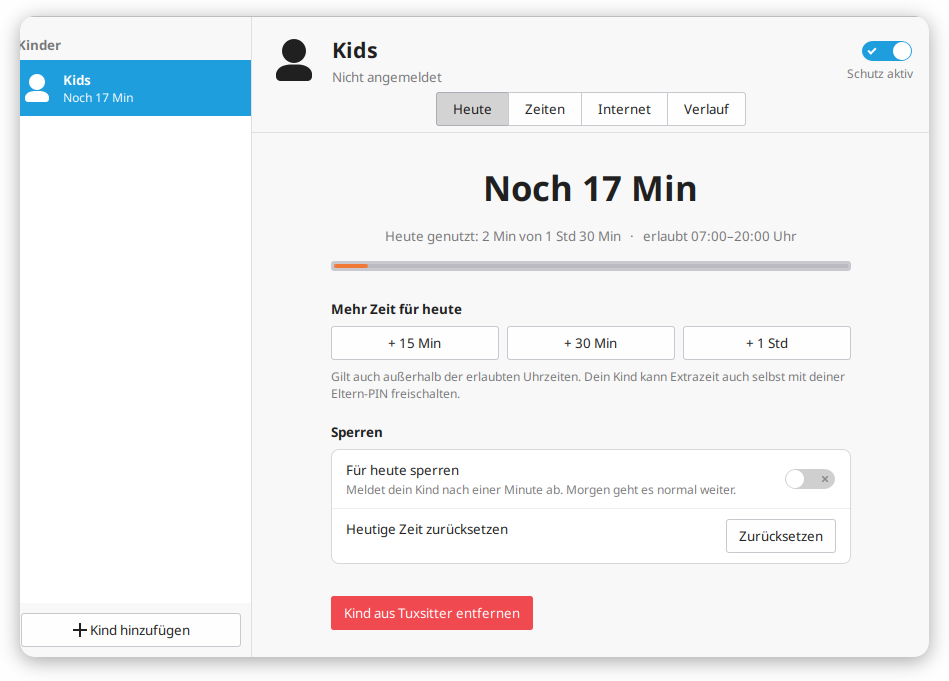
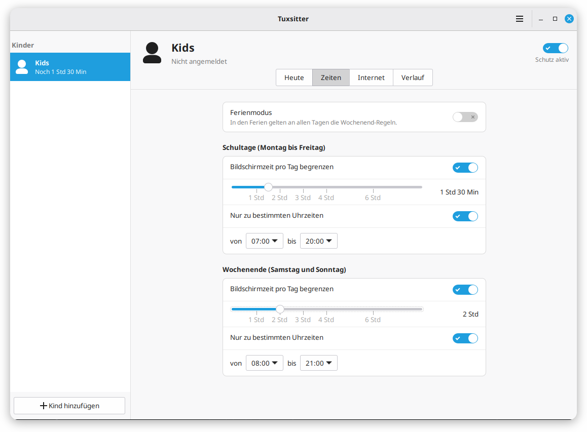
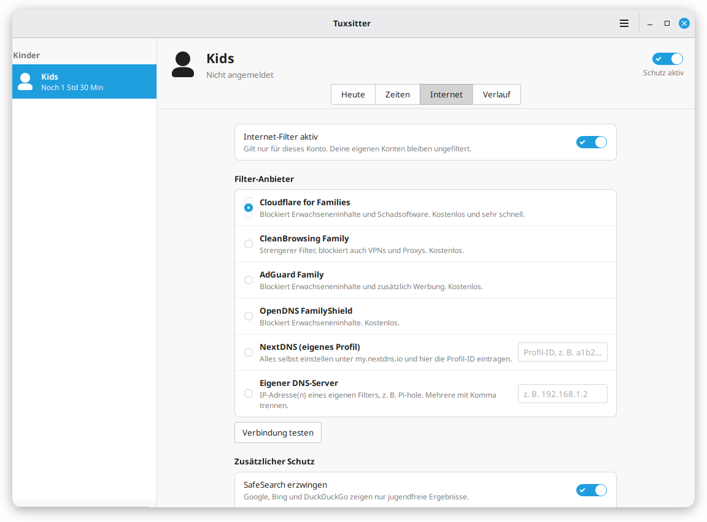
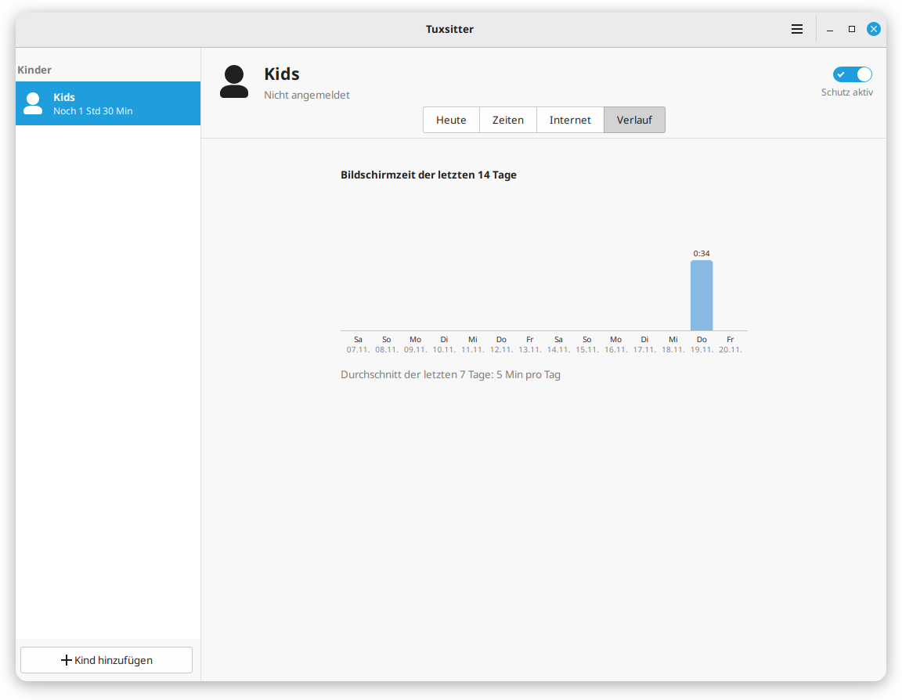

<p align="center">
  
</p>

<h1 align="center">Tuxsitter</h1>

<p align="center">
  <b>Simple parental controls for Linux desktops</b><br>
  Screen time · allowed hours · internet filter for your child's account only
</p>

<p align="center">
  English · <a href="README.de.md">Deutsch</a>
</p>

---

> [!IMPORTANT]
> **Early version - testers wanted!**
> Tuxsitter has so far only been roughly tested on the author's own Linux Mint laptop.
> Thorough testing on many different setups is more than one person can cover - so please
> **try it on your system and [report any problems](https://github.com/chpusch/tuxsitter/issues)**.
> A short note that it *works* on your distribution/desktop is just as helpful. Thank you!

Tuxsitter is a small, friendly babysitter for the family computer. It is made for
**Linux Mint** (Cinnamon) and works on other Ubuntu/Debian based desktops.
Parents get one simple window; the child sees how much time is left in the panel.

## Features

- ⏱ **Daily screen time** - separate limits for school days and weekends, plus a holiday mode
- 🕖 **Allowed hours** - e.g. only between 07:00 and 20:00
- ⚠️ **Fair warnings** - notifications at 15, 5 and 1 minute, then a 60-second countdown before logout
- 🔑 **Extra time with a parent PIN** - right on the child's computer, no need to log in
- 🌐 **Internet filter for the child's account only** - your own accounts stay untouched, queries are encrypted
  - choose a family DNS provider: **OpenDNS FamilyShield (default)**, CleanBrowsing, Cloudflare for
    Families, AdGuard Family, **your own NextDNS profile**, or a custom server (e.g. Pi-hole)
  - enforced **SafeSearch** for Google, Bing and DuckDuckGo
  - **YouTube Restricted Mode** (moderate or strict)
  - **blocks the usual workarounds**: DNS-over-HTTPS / DNS-over-TLS of other providers, hard-coded public resolvers, the Tor download
  - **locks the DNS setting of installed browsers** (Firefox, Chrome, Chromium, Brave, Edge, Vivaldi)
- 📊 **History** of the last 14 days
- 🛡 **Tamper resistant** - runs as a system service; a child without admin rights cannot stop it.
  Tuxsitter warns you if the child's account has admin rights and can remove them.
- 🌍 **Languages**: English, Deutsch, Français, Español

## Screenshots

<table>
  <tr>
    <td align="center"><br><sub>Today: remaining time, extra time, lock</sub></td>
    <td align="center"><br><sub>Schedule: school days, weekend, holidays</sub></td>
  </tr>
  <tr>
    <td align="center"><br><sub>Internet: choose a family DNS filter</sub></td>
    <td align="center"><br><sub>History of the last 14 days</sub></td>
  </tr>
</table>

<sub>The screenshots show the German interface - Tuxsitter follows your system language (English, German, French, Spanish).</sub>

## Installation

### Linux Mint / Ubuntu / Debian

1. Download `tuxsitter_<version>_all.deb` from the [Releases](https://github.com/chpusch/tuxsitter/releases) page.
2. Double-click it and choose **Install Package**, or run:
   ```sh
   sudo apt install ./tuxsitter_*_all.deb
   ```
3. Open **Tuxsitter** from the menu. It asks for your password.

### From source

```sh
git clone https://github.com/chpusch/tuxsitter.git
cd tuxsitter
./tools/build-deb.sh            # creates build/tuxsitter_<version>_all.deb
sudo apt install ./build/tuxsitter_*_all.deb
```

Requirements (installed automatically with the package): `python3`, `python3-gi`, `gir1.2-gtk-3.0`,
`nftables`, `polkit`, `systemd`. Recommended: `gir1.2-xapp-1.0` (panel icon on Cinnamon) or
`gir1.2-ayatanaappindicator3-0.1` (other desktops), and `gir1.2-notify-0.7`.

## Getting started

1. **Set a parent PIN** (first start). With it you can grant extra time on the child's computer.
2. **Add a child**: pick your child's existing account or create a new one.
3. **Schedule**: daily limits and allowed hours for school days and weekends.
4. **Internet**: choose a filter provider and click **Test connection**.
   For NextDNS, enter the profile ID from [my.nextdns.io](https://my.nextdns.io) → *Setup*.
5. The child logs out and in once - the remaining time appears in the panel.

> 💡 Your child's account must **not** be an administrator, otherwise it could simply switch Tuxsitter off.
> For extra safety set a BIOS/UEFI password and disable booting from USB.

## How it works

Tuxsitter has three parts:

| Part | Runs as | Job |
|---|---|---|
| `tuxsitter.service` | root (systemd) | counts screen time, logs the child out, sets the firewall rules |
| `tuxsitter-dns.service` | a temporary user without any rights, in a sandbox (systemd `DynamicUser`) | the DNS filter |
| Parent app (`tuxsitter`) | **you** (no admin rights) | settings, extra time, history |
| Panel indicator | the child | shows remaining time, warnings, PIN dialog |

**Parent app and admin rights.** The parent app runs as your normal user - on X11 and Wayland.
It cannot change anything by itself: every change is sent to the service, which first asks
**polkit** (the desktop's own password dialog) whether you may manage Tuxsitter. Only someone who
knows an administrator password gets through, so the child cannot. The service accepts only a fixed
set of validated commands - there is no "run any command" backdoor.

**Screen time.** Every 10 seconds the service asks `systemd-logind` whether the child is logged in and the
screen is unlocked, and counts that time. When the limit or the allowed hours are reached, the child gets a
one-minute countdown and is then logged out (`loginctl terminate-user`).

**Internet filter.** Linux knows which user account sent every network packet. Tuxsitter adds an
`nftables` rule that redirects *all DNS queries of the child's account* (port 53, to any server) to a small
DNS forwarder inside the service, listening only on `127.0.0.1`/`::1`. The forwarder

1. answers blocked names (DoH servers, `use-application-dns.net`, the Tor website) with "does not exist",
2. maps Google/Bing/DuckDuckGo to their SafeSearch addresses and YouTube to Restricted Mode,
3. forwards everything else to the chosen provider - **encrypted** via DNS-over-HTTPS with certificate
   checking for all built-in providers (a custom server such as a Pi-hole at home uses classic DNS).

In addition, the child's account cannot reach well-known public resolvers (1.1.1.1, 8.8.8.8, 9.9.9.9, …)
or DNS-over-TLS (port 853), so a browser cannot quietly bypass the filter.
If the filter fails, the child gets **no** internet rather than unfiltered internet.

Your own accounts are not affected at all: their DNS keeps going to your router as before.

```
child's browser ──DNS──▶ nftables (uid = child) ──▶ Tuxsitter forwarder ──▶ family filter
your browser    ──DNS──▶ router (unchanged)
```

## Privacy

- No accounts, no cloud, no telemetry, no usage statistics. Settings and usage stay in `/etc/tuxsitter` and `/var/lib/tuxsitter`.
- Tuxsitter does **not** record which websites your child visits - it only counts screen time.
- DNS queries of the child's account go **encrypted** to the provider *you* choose - your internet provider
  or someone on the same Wi-Fi cannot read them. Check the filter provider's privacy policy.
- With NextDNS the device name `Tuxsitter-<username>` is sent, so you can see in your NextDNS logs which
  child made a request.
- **Update check:** the parent app asks GitHub at most once a day whether a newer release exists.
  This is one anonymous request (GitHub sees your IP address, nothing else is sent).
  Switch it off in the menu: *Check for updates*.

## Limitations

No parental control is perfect. Things to be aware of:

- A determined teenager with physical access may find ways around it (live USB stick, other device,
  VPNs not known to the filter provider). Talking about the rules helps more than any software.
- **Unknown encrypted-DNS servers:** DNS-over-HTTPS looks like normal web traffic. Tuxsitter blocks the
  well-known DoH servers and locks the DNS setting of installed browsers, but a browser the child installs
  itself (e.g. a Flatpak) could use a small, unknown DoH server. The default **OpenDNS FamilyShield** blocks such
  servers, VPN and proxy sites as well (so does CleanBrowsing, or NextDNS with "Block bypass methods").
  Cloudflare and AdGuard do not - avoid them for older, tech-savvy children.
- The DNS filter blocks domains, not individual pages.
- Time is counted per computer. Multiple computers each need Tuxsitter.
- Roughly tested on Linux Mint (Cinnamon) only. Other desktops should work; the panel icon needs
  AppIndicator support (GNOME users need the *AppIndicator* extension).

## Uninstall

```sh
sudo apt remove tuxsitter   # keeps settings
sudo apt purge tuxsitter    # removes everything
```

The firewall rules are removed automatically.

## Useful commands

```sh
python3 /usr/lib/tuxsitter/check_providers.py   # live test of all filter providers
systemctl status tuxsitter tuxsitter-dns   # are both services running?
journalctl -u tuxsitter -f            # log
sudo nft list table inet tuxsitter    # current firewall rules
```

## Translations

Tuxsitter speaks English, German, French and Spanish. New languages are very welcome - see
[CONTRIBUTING.md](CONTRIBUTING.md#translations). It takes about an hour and no programming.

## Development

```sh
python3 -m unittest discover -s tests -t .   # tests (no GTK needed)
python3 tools/update-po.py                    # refresh po/ after changing texts
./tools/build-deb.sh                          # build the .deb
```

Project layout:

```
src/tuxsitter/   daemon.py (service) · dnsfilter.py · gui.py (parent app) · tray.py (indicator)
data/            .desktop files, systemd unit, polkit policy, icons
po/              translations
packaging/deb/   Debian package metadata
tools/           build and translation scripts
tests/           unit tests
```

## License

[GPL-3.0-or-later](LICENSE). The penguin icon is original artwork made for this project
(it is not Larry Ewing's Tux).
